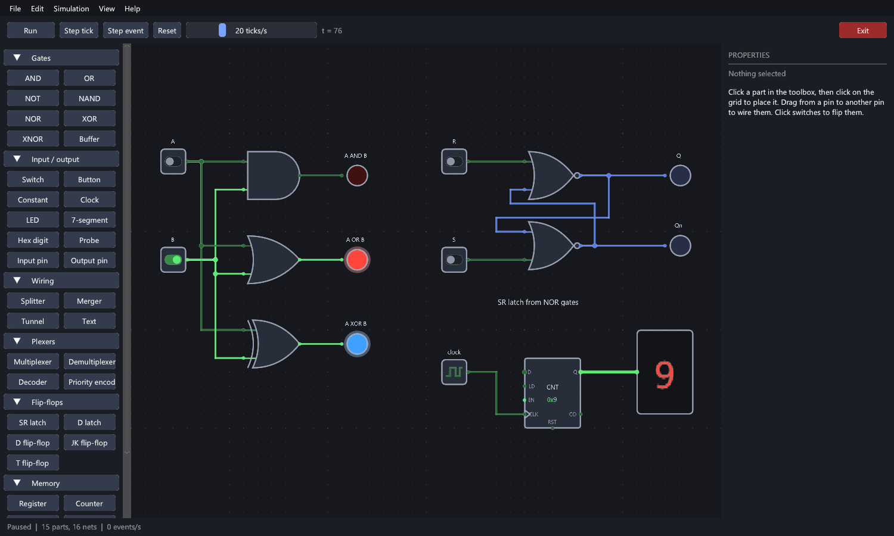

#  LogicSim

[](https://github.com/sandersirge/LogicSim/actions/workflows/ci.yml)

A logic-gate simulator: place gates on a grid, wire them together and watch the signals
propagate, from single gates to adders, latches, counters and memory.

C++23, SFML 3.1 and Dear ImGui. The simulation engine (`src/core`) has no GUI dependency and is
covered by unit tests.



## Download

Ready-to-run downloads for Windows (zip), Linux (AppImage or tar.gz) and macOS (zipped app) are on
the [Releases](https://github.com/sandersirge/LogicSim/releases) page; they need nothing else
installed and include the example circuits. The Linux tar.gz uses the X libraries every desktop
has (`libxcursor1` and `libxi6` on a minimal system); the AppImage brings its own. On macOS
right-click the app and choose Open the first time (it is not signed with an Apple certificate).

## Features

- Gates: AND, OR, NOT, NAND, NOR, XOR, XNOR, buffer (2–8 inputs, 1–32 bit buses)
- Inputs and outputs: switch, button, constant, clock, LED, 7-segment display, hex digit, probe,
  input and output pins
- Wiring: splitter, merger, tunnel (named connection), text notes
- Plexers: multiplexer, demultiplexer, decoder, priority encoder
- Flip-flops: SR latch, D latch, D / JK / T flip-flops with asynchronous set and reset
- Memory: register, counter, RAM, ROM
- Event-driven simulation with gate delays: feedback loops work (latches hold, ring
  oscillators oscillate), every wire is unknown (X, blue) until something drives it
- Run, pause, step one tick or one event, speed from 1 to 100 000 ticks per second
- Edit while it runs: moving, rotating or wiring keeps the stored values (flip-flops, counters,
  RAM, latches made of gates) and the time; Reset powers the circuit on again
- Wires of different signals lying on top of each other (they look connected but are not) are
  shown in orange, with a warning; a new wire drawn without bends takes a free column
- Custom chips: select a circuit with its input and output pins and make it a chip; place it from
  the toolbox, open it to change its inside (every instance follows), nest chips in chips, and
  import / export chip libraries
- Undo / redo, copy / paste, rotate, save and open circuits as JSON

## Chips

Select a circuit together with its Input pin and Output pin parts and click **New chip from
selection** in the toolbox. The pins become the chip's pins, top to bottom, named after their
labels. The chip appears in the toolbox's Chips section; click it to place an instance.

Double-click an instance (or select it and click **Open chip**) to edit its inside: the canvas
gets a blue frame and a breadcrumb bar shows where you are. Its input pins can be clicked to try
it out. Changes apply to every instance; wires to an instance follow its pins when they are
renamed or moved, and the circuit outside goes on from where it was when you return. With nothing
selected the properties panel renames the chip and sets its colour and description. A chip cannot
contain itself. Right-click a chip in the toolbox to open or delete it (only unused chips can be
deleted).

File > Export chips saves every chip of the circuit as a chip library; File > Import chips adds
the chips of a library or circuit file (a chip with a taken name that differs is renamed, and
the chips using it follow).

## Building

Needs CMake 3.28+, a C++23 compiler and SFML 3.1. CMake downloads Dear ImGui, ImGui-SFML and
nlohmann/json, and also SFML if it is not installed.

Windows (MSYS2 UCRT64):

```
pacman -S mingw-w64-ucrt-x86_64-gcc mingw-w64-ucrt-x86_64-cmake mingw-w64-ucrt-x86_64-ninja mingw-w64-ucrt-x86_64-sfml
make            # build into build/
make run        # build and start the app
make test       # build and run the tests
```

Linux / WSL / macOS: the same `make` targets (install SFML 3 with your package manager, or let
CMake build it). Without make:

```
cmake -S . -B build -DCMAKE_BUILD_TYPE=Release
cmake --build build
ctest --test-dir build --output-on-failure
build/bin/logicsim examples/basics.json
```

`-DLOGICSIM_BUILD_GUI=OFF` builds only the engine and its tests (no SFML or ImGui needed).
Every option, CLion, formatting, the icon, CI and releases: [docs/building.md](docs/building.md).

## Using it

| Do this | To |
|---|---|
| Click a part in the toolbox, then click on the grid | place it (hold Shift to place more) |
| Drag from a pin to another pin | wire them; clicks on the grid on the way add bends |
| Drag from the middle of a wire | branch it: a new wire from the same output, with a dot where it splits |
| Click a switch, or a bit of an input pin | flip it (hold a button down) |
| Drag a part / drag on empty grid | move it / select an area |
| Double-click a chip | open it to edit its inside (the breadcrumbs lead back) |
| Right or middle drag, mouse wheel | pan, zoom |
| Right click or Esc | cancel wiring or placing (Esc during a drag puts the parts back) |
| R, Del, Ctrl+C / X / V / D, Ctrl+Z / Y | rotate, delete, copy / cut / paste / duplicate, undo / redo |
| Space, `.` | run or pause, step one tick |
| F | fit the circuit in view |
| Exit (toolbar), Ctrl+Q | quit (asks first when there are unsaved changes) |

Wire colours: bright green 1, dark green 0, blue unknown (X), yellow partly known. Hover a pin
to see its value in the status bar.

Example circuits are in `examples/` (File > Examples): basics, a gallery of every part, a shift
register, a 4-bit ALU built from nested adder chips, a D latch and a master-slave flip-flop made
of gates, a ring oscillator, a counter on a 7-segment display, a multiplexer and decoder, a
register file and RAM.

`logicsim circuit.json --screenshot out.png --ticks 50` saves a picture after 50 ticks and quits;
`logicsim --help` lists the options. Help > About shows the version.
